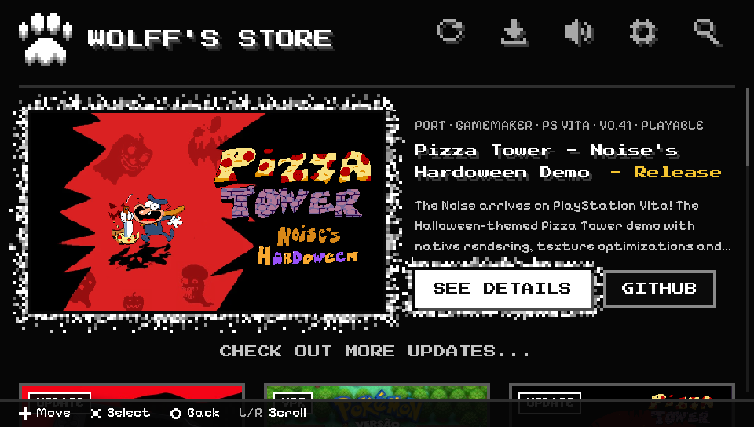
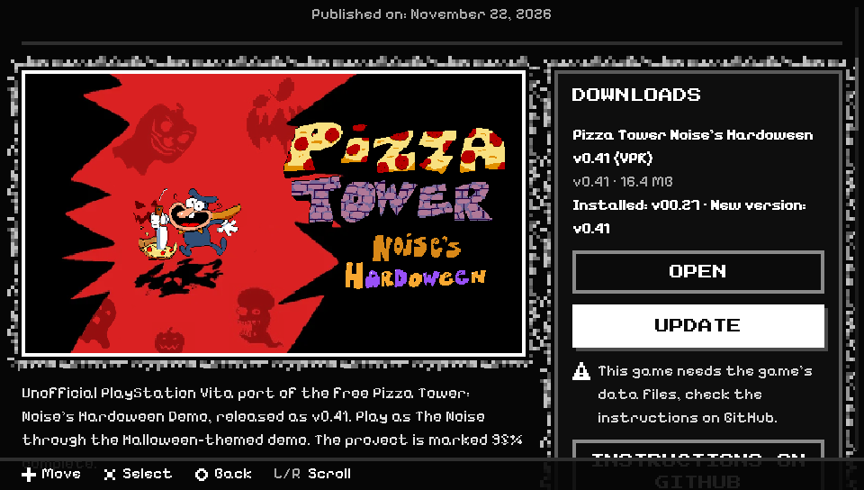

<div align="center">


<br>

**Wolff's Room, right on your PlayStation Vita.**

*Browse homebrew, ports, translations, mods, and community updates in a native PS Vita app.*

[**Download**](https://github.com/WolffsRoom/WolffsStore/releases/latest) · [**Visit Website**](https://wolffsroom.github.io/WolffsRoomSite/) · [**Source Code**](https://github.com/WolffsRoom/WolffsStore)

[](https://www.playstation.com/ps-vita/)
[](https://github.com/WolffsRoom/WolffsStore/releases/latest)
[](LICENSE)


</div>

---

## Overview

**Wolff's Store** is an independent, native homebrew application that brings the [Wolff's Room](https://wolffsroom.github.io/WolffsRoomSite/) catalog to the PlayStation Vita.

Explore game ports, homebrew applications, utilities, plugins, translations, mods, and development news in a pixel-art interface inspired by the website. The Store supports **English and Brazilian Portuguese**, controller and touch input, animated transitions, sound effects, and background music.

Content is maintained in the **[WolffsRoomSite](https://github.com/WolffsRoom/WolffsRoomSite)** repository. The Vita app synchronizes its catalog over the network and can fall back to cached or bundled data when offline.

### Features

- **Home and categories:** featured projects, recent updates, release carousel, Ports, Apps/Mods, Translations, and Journal.
- **Project pages:** descriptions, screenshots, videos, technical details, release information, and external links.
- **Downloads and installation:** queue and progress indicators, VPK installation, compatible translation packages, and supported plugins or game-data packages.
- **Installation awareness:** identify installed titles and offer updates when version information is available.
- **Automatic Store updates:** download a newer release and hand off installation to the separate updater.
- **Community polls:** participate in supported polls through the configured HTTPS voting service, with one vote per console per poll.
- **Bilingual interface:** English / Português (Brasil), including localized catalog content.
- **Native presentation:** pixel-art animations, UI sounds, selectable background music, touch controls, and brightness options.
- **Offline fallback:** continue browsing previously cached catalog content without an active connection.
- **GitHub download totals:** display verified release-asset download counts when available for a project.

Availability and installation behavior depend on each project's download format and metadata. Some downloads remain external or require additional game files.

---

## Screenshots

<table align="center">
  <tr>
    <td align="center" width="50%">
      <a href="docs/screenshots/01-home.png"></a>
      <br><sub><b>Home</b> — Featured project and recent updates</sub>
    </td>
    <td align="center" width="50%">
      <a href="docs/screenshots/02-project-downloads.png"></a>
      <br><sub><b>Project details</b> — Cover art and download options</sub>
    </td>
  </tr>
</table>

<sub>Captured directly from Wolff's Store running in Vita3K at 960 × 544. Screenshots show the emulator build; actual hardware presentation may vary.</sub>

---

## Download & Installation

1. Download **`WolffsStore.vpk`** from the [latest GitHub release](https://github.com/WolffsRoom/WolffsStore/releases/latest).
2. Transfer the VPK to your homebrew-enabled PS Vita.
3. Install it with **VitaShell**, then launch **Wolff's Store** from LiveArea.
4. Connect to the internet to synchronize the latest catalog.

**Application Title ID:** `WFFS00042`  
**Updater Title ID:** `WFFS00043`

The Store includes an initial catalog and its own application resources. Additional post artwork and catalog data are cached as needed. Some projects require files that are **not** included with the Store.

### Updates

The Store checks for newer releases and can use the updater to install an update after the main app closes. The updater is kept as a reusable helper instead of being deleted while the Store is running, avoiding a known LiveArea interruption.

You can also update manually by installing the latest VPK. Your application settings and downloaded catalog data are stored separately under `ux0:data/WolffsStore/`.

---

## Controls

| Input | Action |
|---|---|
| D-pad / Left analog stick | Navigate |
| ✕ (Cross) | Select / Open |
| ○ (Circle) | Back |
| △ (Triangle) | Synchronize catalog |
| □ (Square) | Downloads |
| L / R, Right analog stick, touch drag | Scroll |
| SELECT | Search |
| START | Settings |

Touch controls are also supported throughout the interface. Some buttons behave differently while a dialog, download, or opening animation is active.

---

## How It Works

The website provides the content; **Wolff's Store** provides the native Vita interface, downloads, and installation workflow.

```text
           WolffsRoomSite
       (Markdown posts + assets)
                  |
           Python catalog
          (tools/gen_data.py)
                  |
       Bundled + online catalog
                  |
             Wolff's Store
        (native PS Vita frontend)
           /       |       \
     Browse       Download   Journal
      posts       / Install  / Polls
         |            |         |
   Local cache    Vita system   HTTPS
                   services     backend
```

### Project Structure

| Path | Description |
|---|---|
| `src/` | Native PS Vita UI, catalog, network, download, install, audio, and poll code. |
| `updater/` | Separate update helper (`WFFS00043`). |
| `tools/gen_data.py` | Generates the bundled catalog and assets from WolffsRoomSite content. |
| `data/` | Generated catalog and bundled application resources. |
| `assets/` | Application artwork, fonts, LiveArea assets, and other source resources. |
| `scripts/build.ps1` | Windows/Docker build entry point. |
| `.github/workflows/release.yml` | GitHub Actions VPK build and release workflow. |
| `tests/` | Automated regression tests. |

### Network & Data

- The Store uses **libcurl and OpenSSL** for network access.
- The poll client uses an explicitly verified HTTPS path and a bundled certificate file. This should **not** be interpreted as full TLS verification for every legacy network operation.
- Polls use a pseudonymous device-derived identifier for one-vote-per-console enforcement; the raw OpenPSID is not transmitted.
- Cache, settings, installation records, and diagnostic files are kept under `ux0:data/WolffsStore/`.

The Store does not include a GitHub API token or the Cloudflare voting service's private credentials.

---

## Building

The project uses **VitaSDK**, CMake, and a Docker-based build workflow. On Windows, install Docker Desktop and ensure Docker is available in PowerShell.

Build using the existing generated catalog:

```powershell
powershell -ExecutionPolicy Bypass -File scripts\build.ps1
```

Regenerate bundled data from a local checkout of [WolffsRoomSite](https://github.com/WolffsRoom/WolffsRoomSite/) before building:

```powershell
pip install pillow pyyaml
powershell -ExecutionPolicy Bypass -File scripts\build.ps1 -Site C:\path\to\WolffsRoomSite
```

Successful builds produce:

```text
artifacts/current/WolffsStore.vpk
```

The build script uses `atamanenko/vitasdk-softfp:latest` locally. GitHub Actions uses its own VitaSDK container; pushing a `v*` tag triggers the release workflow, which publishes `WolffsStore.vpk`.

---

## Links

- **Website:** https://wolffsroom.github.io/WolffsRoomSite/
- **Latest Store release:** https://github.com/WolffsRoom/WolffsStore/releases/latest
- **Website source and content:** https://github.com/WolffsRoom/WolffsRoomSite
- **GitHub:** https://github.com/WolffsRoom
- **YouTube:** https://www.youtube.com/@WolffsRoom

---

## Credits & License

Wolff's Store is distributed under the **[GNU General Public License v3.0](LICENSE)**.

The VPK installation and updater workflow draws on **VitaShell** by **TheFloW** and **VitaSeed**. The project uses open-source libraries including VitaSDK, vita2d, libcurl, and OpenSSL. Fonts include **Press Start 2P** and **Pixelify Sans**, subject to their respective SIL Open Font License terms.

Project artwork, game assets, trademarks, and screenshots belong to their respective owners. The Store does not grant rights to distribute copyrighted game files.

---

## Disclaimer

*Wolff's Store is an independent, unofficial PS Vita homebrew project and is not affiliated with Sony Interactive Entertainment or the original developers and publishers.*

<div align="center">

---

*Wolff's Room © 2026*

</div>
